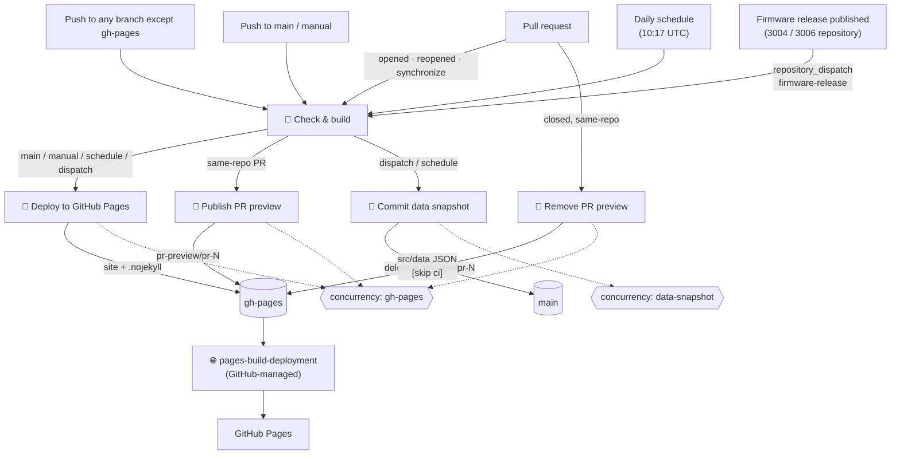

# CI/CD pipeline

The build job writes this map to its run summary; the cleanup job does the same when a PR
closes.

- **`🧪 Check & build`** runs for every push (except `gh-pages`), every pull request
  except `closed`, the daily scheduled refresh, and a `firmware-release`
  `repository_dispatch` from the 3004/3006 repositories. It resolves the Pages
  origin/base path, refreshes the GitHub stats and release-note snapshots with `pnpm stats`
  (authenticated by `GITHUB_TOKEN`; dispatch runs also receive `FIRMWARE_REPOSITORY` and
  `FIRMWARE_TAG`), runs `pnpm check` and `pnpm build`, and uploads `dist`. On non-PR events
  it also uploads `src/data/github-stats.json` and `src/data/github-releases.json` as the
  one-day `data-snapshots` artifact.
- **`🚀 Deploy to GitHub Pages`** runs for `main` pushes, manual runs, the daily scheduled
  refresh and firmware dispatches. It downloads the `dist` artifact and pushes it to
  `gh-pages`.
- **`💾 Commit data snapshot`** runs for `repository_dispatch` and the daily schedule after
  a successful build. It checks out the default branch, downloads the `data-snapshots`
  artifact into `src/data`, and commits the two JSON files as `github-actions[bot]` with
  `[skip ci]` when they changed. It rebases onto `origin/$GITHUB_REF_NAME` before pushing
  and uses the `data-snapshot` concurrency group. It does not write to `gh-pages`.
- **`👀 Publish PR preview`** runs for same-repository pull requests. Fork PRs still get
  the read-only build job, but they do not get a preview because the deploy action needs a
  write token.
- **`🧹 Remove PR preview`** runs when a same-repository PR closes. The build job is
  skipped for that event, so cleanup uses `always()`.
- The deploy, preview and cleanup jobs share the `gh-pages` concurrency group. Builds can
  run in parallel, but no two jobs write to `gh-pages` at the same time. The snapshot job
  is independent; `data-snapshot` serialises snapshot commits.
- `🌐 pages-build-deployment` is GitHub Pages' own workflow. It is not part of this file
  and cannot be renamed or emojified.
- **Firmware release provenance:** `release: published` in either firmware repository
  starts `notify-website.yml` there. That workflow checks the tag prefix, creates a GitHub
  App installation token scoped to `website.gnuton` (`Contents: write`) and sends the
  `firmware-release` dispatch with `repository`, `tag` and `prerelease`. The App is
  installed only on the website repository; the firmware repositories hold the
  `WEBSITE_APP_ID` / `WEBSITE_APP_PRIVATE_KEY` secrets. The daily cron remains the
  reconciliation path if the dispatch is delayed or missing.
- GitHub's native run graph shows jobs and `needs` dependencies inside this workflow, not
  triggers or `pages-build-deployment`. This map is the trigger-level view.
