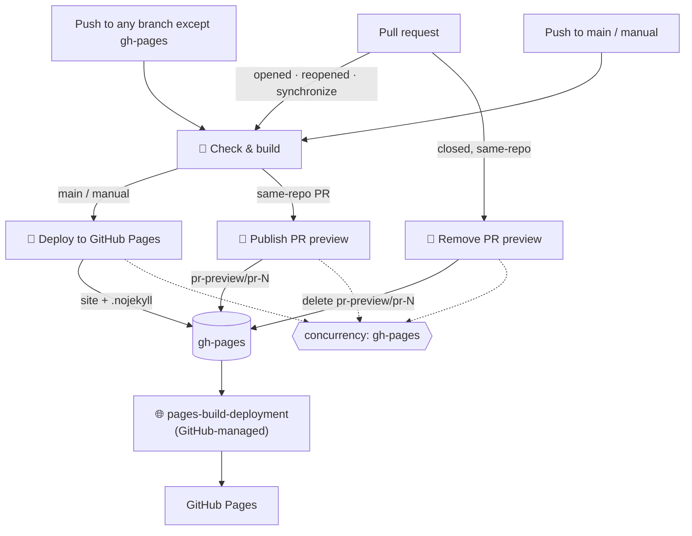

# CI/CD pipeline

The build job writes this map to its run summary; the cleanup job does the same when a PR
closes.

- **`🧪 Check & build`** runs for every push (except `gh-pages`) and every pull request
  except `closed`. It resolves the Pages origin/base path, runs `pnpm check` and
  `pnpm build`, and uploads `dist` as an artifact.
- **`🚀 Deploy to GitHub Pages`** runs for `main` pushes and manual runs. It downloads the
  artifact and pushes it to `gh-pages`.
- **`👀 Publish PR preview`** runs for same-repository pull requests. Fork PRs still get
  the read-only build job, but they do not get a preview because the deploy action needs a
  write token.
- **`🧹 Remove PR preview`** runs when a same-repository PR closes. The build job is
  skipped for that event, so cleanup uses `always()`.
- The deploy, preview and cleanup jobs share the `gh-pages` concurrency group. Builds can
  run in parallel, but no two jobs write to `gh-pages` at the same time.
- `🌐 pages-build-deployment` is GitHub Pages' own workflow. It is not part of this file
  and cannot be renamed or emojified.
- GitHub's native run graph shows jobs and `needs` dependencies inside this workflow, not
  triggers or `pages-build-deployment`. This map is the trigger-level view.
